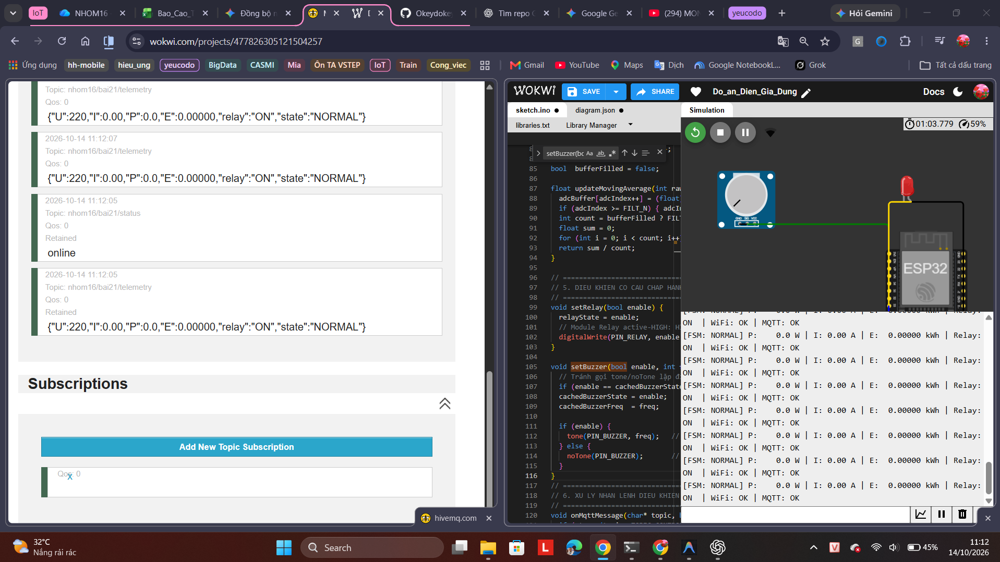
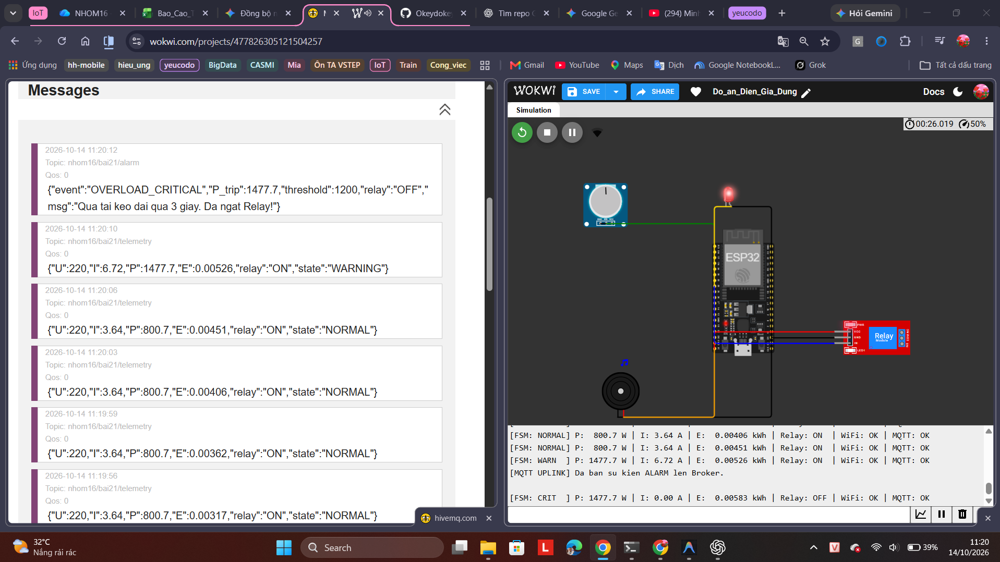
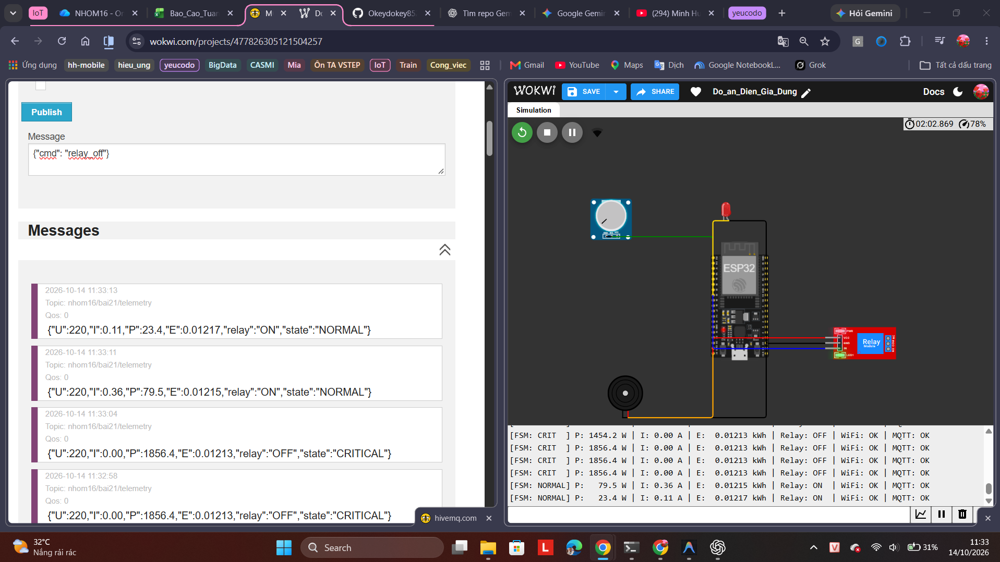
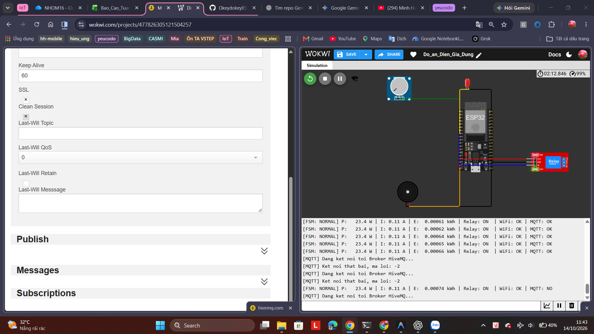
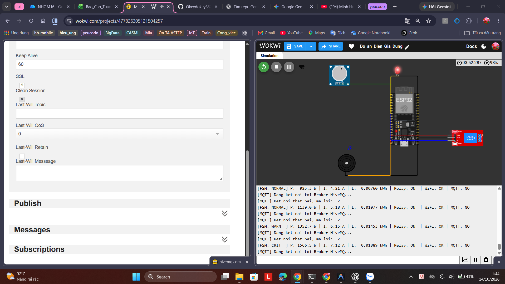
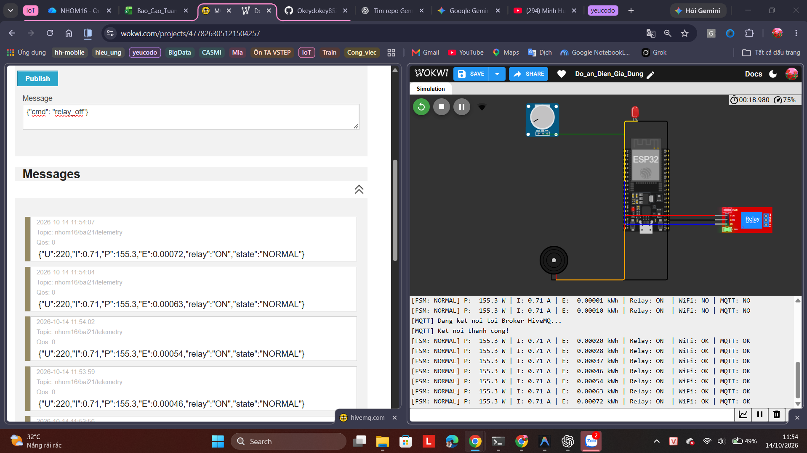
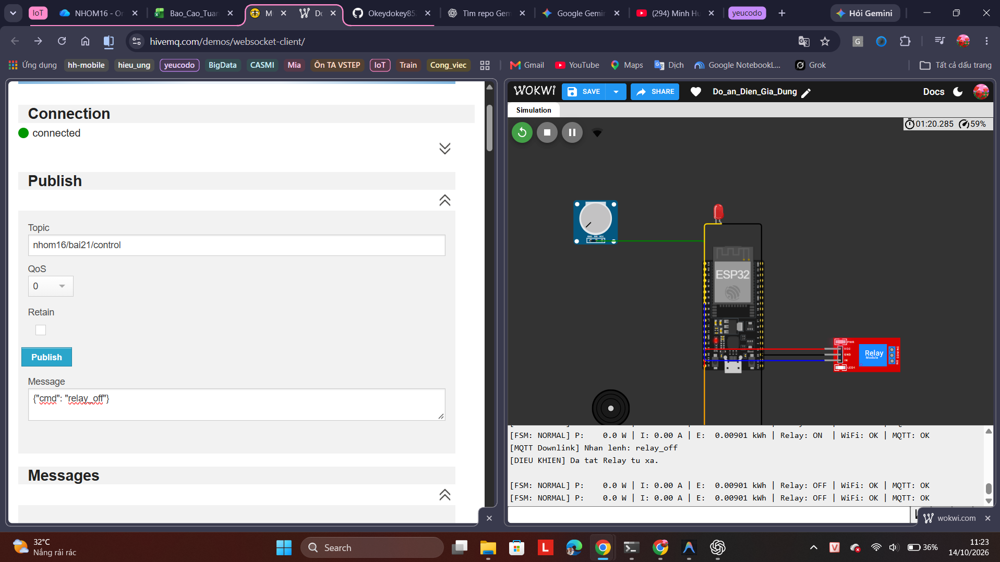

# HỆ THỐNG IOT GIÁM SÁT VÀ CẢNH BÁO BẤT THƯỜNG ĐIỆN NĂNG CỦA THIẾT BỊ DÂN DỤNG

> **Trường:** Đại học Công Thương TP. Hồ Chí Minh (HUIT)  
> **Giảng viên hướng dẫn:** ThS. Võ Hoàng Hải  
> **Nhóm thực hiện:** Nhóm 16  
> - **Lê Đức Lương** - MSSV: `2001230490`  
> - **Trần Lê Đức Trí** - MSSV: `2001230486`  

[](https://wokwi.com/projects/477826305121504257)

---

## 1. Giới thiệu Đề tài

Dự án nghiên cứu và triển khai mô hình IoT giám sát mức tiêu thụ điện năng của các thiết bị dân dụng (nồi cơm điện, quạt, tivi, bình đun, máy giặt...) trong thời gian thực. Hệ thống tự động phân tích và phát hiện các tình huống bất thường (quá tải, chập cháy, quên tắt thiết bị) nhằm đưa ra cảnh báo kịp thời bằng âm thanh, ánh sáng và dữ liệu log.

---

## 2. Sơ đồ phần cứng & Nối dây (Wokwi Simulation)

Dự án được mô phỏng trên nền tảng **Wokwi** với các linh kiện được định nghĩa trong file [`diagram.json`](diagram.json):

> 🔗 **Link mô phỏng trực tiếp trên Wokwi:** [https://wokwi.com/projects/477826305121504257](https://wokwi.com/projects/477826305121504257)
>
> Nhấn nút **Start** trên trang Wokwi để chạy mô phỏng mà không cần cài đặt gì thêm.

| Linh kiện | Loại linh kiện (Wokwi Type) | Chân linh kiện | Chân ESP32 kết nối | Ghi chú chức năng |
| :--- | :--- | :--- | :--- | :--- |
| **ESP32** | `board-esp32-devkit-c-v4` | - | - | Vi điều khiển trung tâm |
| **Biến trở (Pot)** | `wokwi-potentiometer` | `GND` | `GND.1` | Cấp mass |
| | | `VCC` | `3V3` | Cấp nguồn 3.3V |
| | | `SIG` | `GPIO 34` | Mô phỏng tải tiêu thụ điện ($0 \to 3000\text{ W}$) |
| **Đèn LED đỏ** | `wokwi-led` | Katot (`C`) | `GND.2` | Cực âm |
| | | Anot (`A`) | `GPIO 25` | Báo động thị giác khi có bất thường |
| **Còi Buzzer** | `wokwi-buzzer` | Chân `1` | `GND.2` | Cực âm |
| | | Chân `2` | `GPIO 26` | Phát âm thanh báo động tần số cao qua PWM |
| **Relay 5V 10A** | `wokwi-relay-module` | `VCC` | `5V` (hoặc `3V3`) | Cấp nguồn cuộn hút relay |
| | | `GND` | `GND.2` | Nối mass chung |
| | | `IN` | `GPIO 33` | Tín hiệu logic điều khiển ngắt/đóng điện |
| **Serial Monitor** | `$serialMonitor` | `RX` | `esp:TX` (GPIO 1) | Xuất log dữ liệu ra Terminal |
| | | `TX` | `esp:RX` (GPIO 3) | Nhận lệnh điều khiển |

---

## 3. Nguyên lý Hoạt động & Công thức Tính toán

Hệ thống lấy mẫu ADC mỗi $10\text{ ms}$, làm mịn tín hiệu bằng **Bộ lọc Trung bình Trượt 8 mẫu (Moving Average Filter)**, chạy vòng lặp FSM liên tục (non-blocking) và in báo cáo giám sát mỗi $1\text{ s}$:

1. **Đọc cảm biến công suất (Biến trở ADC) & lọc trung bình trượt:**
   $$\text{rawADC} = \text{analogRead}(34) \quad (0 \le \text{rawADC} \le 4095)$$
   $$\overline{\text{rawADC}} = \frac{1}{8}\sum_{i=1}^{8}\text{rawADC}_i \quad \text{(Moving Average 8 mẫu - loại xung đỉnh/dao động)}$$
2. **Tính công suất tiêu thụ tức thời ($P$) trên giá trị đã lọc:**
   $$P = \frac{\overline{\text{rawADC}}}{4095} \times 3000.0\text{ (W)}$$
3. **Tính dòng điện tải ($I$) với điện áp danh định $U = 220\text{ V}$:**
   $$I = \frac{P}{U} = \frac{P}{220.0}\text{ (A)}$$
4. **Tính điện năng tiêu thụ tích lũy ($E$ theo kWh):**
   $$E_{t} = E_{t-1} + \frac{P \times \Delta t}{3600 \times 1000}\text{ (kWh)}$$

---

## 4. Các Tình huống Cảnh báo Bất thường (Anomaly Detection)

| Trạng thái | Điều kiện kích hoạt | Hành vi phần cứng (Actuators) | Trạng thái Relay 5V | Ý nghĩa nghiệp vụ |
| :--- | :--- | :--- | :--- | :--- |
| **NORMAL** | $P \le 1200\text{ W}$ | - LED: **TẮT**<br>- Còi: **TẮT** | **ĐÓNG (ON)**<br>*Cấp điện cho tải* | Thiết bị hoạt động trong giới hạn an toàn. |
| **WARNING** | $P > 1200\text{ W}$ (tức thời) | - LED: **ĐỎ SÁNG**<br>- Còi: **TẮT** | **VẪN ĐÓNG (ON)**<br>*Chưa cắt điện* | Cảnh báo sớm tải vượt ngưỡng; bắt đầu bấm giờ trễ $3\text{s}$ (`millis()`). |
| **CRITICAL** | $P > 1200\text{ W}$ liên tục $> 3\text{ s}$ | - LED: **ĐỎ SÁNG**<br>- Còi: **HÚ ($1500\text{ Hz}$)** | **NGẮT (OFF)**<br>*Cắt điện bảo vệ* | Quá tải nguy hiểm kéo dài; ngắt mạch bảo vệ an toàn. |
| *(Phục hồi)* | $P < 1100\text{ W}$ (Hysteresis) | - LED: **TẮT**<br>- Còi: **TẮT** | **ĐÓNG LẠI (ON)** | Trở lại NORMAL; tránh dội tiếp điểm relay (chattering) khi $P$ dao động quanh ngưỡng. |

---

## 5. Hướng dẫn Cài đặt & Chạy Mô phỏng (Dành cho Người mới)

### Bước 1: Chuẩn bị Môi trường
Cần cài đặt sẵn trên máy tính:
- **Visual Studio Code** (hoặc Antigravity IDE).
- Extension **PlatformIO IDE** (để build code ESP32).
- Extension **Wokwi Simulator** (để chạy mạch mô phỏng).

> **Lưu ý về License Wokwi:** Khi dùng lần đầu, nhấn `Ctrl+Shift+P` $\to$ chọn `Wokwi: Request a 30-day Free License` và làm theo hướng dẫn trên web để kích hoạt.

### Bước 2: Biên dịch Firmware (Build)
Mở Terminal trong thư mục dự án (`c:\LeDucLuong\HK VII\IoT\Buoi04`), chạy lệnh:
```powershell
pio run
```
Khi thấy dòng `[SUCCESS]` nghĩa là file nạp `.pio/build/esp32dev/firmware.bin` và `firmware.elf` đã được tạo thành công.

### Bước 3: Khởi chạy Wokwi Simulator
1. Mở file [`diagram.json`](diagram.json).
2. Nhấn `Ctrl + Shift + P` (hoặc `F1`).
3. Gõ tìm kiếm: **`Wokwi: Start Simulator`** $\to$ nhấn **Enter**.
4. Tab mô phỏng Wokwi sẽ hiện ra kèm bảng mạch ESP32, biến trở, đèn LED và còi buzzer.

### Bước 4: Xem kết quả trên Terminal
Bạn có thể xem dữ liệu in ra theo 2 cách:
- **Cách 1 (Tự động):** Nhìn trực tiếp vào khung **"Wokwi Terminal"** ở tab Terminal phía dưới của IDE.
- **Cách 2 (PlatformIO Monitor qua RFC2217):** Mở một tab Terminal mới và chạy lệnh:
  ```powershell
  pio device monitor --port rfc2217://localhost:4444 --baud 115200
  ```

### Bước 5: Thử nghiệm tương tác
- Dùng chuột **xoay núm vặn của biến trở (Potentiometer)** trên màn hình:
  - Vặn lên $> 40\%$ ($P > 1200\text{ W}$) $\to$ Trạng thái **WARNING**: đèn LED đỏ sáng, còi chưa kêu, **relay vẫn đóng** (cảnh báo sớm).
  - **Giữ nguyên** mức quá tải liên tục $> 3$ giây $\to$ Trạng thái **CRITICAL**: còi Buzzer hú $1500\text{ Hz}$ và relay **ngắt điện** bảo vệ tải.
  - Vặn xuống dưới $36\%$ ($P < 1100\text{ W}$, hysteresis) $\to$ Hệ thống tự phục hồi về **NORMAL**, relay đóng lại.

---

## 6. Mẫu Dữ liệu Hiển thị (Serial Monitor)

```text
==================================================
 [IoT Nhom 16] - KHOI DONG HE THONG BAO VE QUA TAI
 Che do FSM: NORMAL -> WARNING (3s) -> CRITICAL
==================================================

[FSM: NORMAL  ] | U: 220.0V | I:  1.36A | P:  300.0W | E: 0.00008 kWh | Relay: ON  | LED: 0 | Buzzer: 0
[FSM: WARNING ] | U: 220.0V | I:  6.82A | P: 1500.0W | E: 0.00050 kWh | Relay: ON  | LED: 1 | Buzzer: 0   <- LED do, van cap dien
[FSM: WARNING ] | U: 220.0V | I:  6.82A | P: 1500.0W | E: 0.00092 kWh | Relay: ON  | LED: 1 | Buzzer: 0   <- qua tai > 3s
[FSM: CRITICAL] | U: 220.0V | I:  6.82A | P: 1500.0W | E: 0.00092 kWh | Relay: OFF | LED: 1 | Buzzer: 1   <- cat tai bao ve
[FSM: NORMAL  ] | U: 220.0V | I:  0.45A | P: 100.0W  | E: 0.00092 kWh | Relay: ON  | LED: 0 | Buzzer: 0   <- phuc hoi (hysteresis)
```

> Ghi chú: $I = P/220$ (dòng tải lý thuyết). Điện năng $E$ chỉ tích lũy khi relay đang **đóng** (tải thực sự được cấp điện).

---

## 7. Các Lỗi Thường Gặp & Cách Khắc Phục (Troubleshooting)

1. **Lỗi Serial Monitor không in chữ gì:**
   - **Nguyên nhân:** Wokwi chưa nối đường UART vào `$serialMonitor`.
   - **Khắc phục:** Đã bổ sung 2 dòng nối dây trong `diagram.json`:
     `["esp:TX", "$serialMonitor:RX", "", []]` và `["esp:RX", "$serialMonitor:TX", "", []]`.
2. **Lỗi cổng `listen EADDRINUSE :4000`:**
   - **Nguyên nhân:** Cổng 4000 bị trùng với tiến trình khác.
   - **Khắc phục:** Đã cấu hình sang cổng `4444` trong `wokwi.toml` (`rfc2217ServerPort = 4444`).
3. **Lỗi đỏ `LEDC is not initialized`:**
   - **Nguyên nhân:** Dùng hàm `noTone()` của Arduino gây lỗi driver khi còi chưa kêu.
   - **Khắc phục:** Chuyển sang dùng chuẩn PWM gốc của ESP32 (`ledcSetup`, `ledcAttachPin`, `ledcWriteTone`), triệt tiêu 100% lỗi đỏ.
4. **Lỗi chữ bị lệch bậc thang (stair-stepping):**
   - **Nguyên nhân:** In bằng `printf` chỉ có `\n` thiếu `\r`.
   - **Khắc phục:** Chuẩn hóa toàn bộ xuống dòng thành `\r\n`.

---

## 8. Tầng mạng MQTT & Ma trận Kiểm thử (Tuần 8)

### 8.1. Bản đồ Topic & Định dạng Payload (JSON)

| Kênh | Topic | Hướng | Tần suất | Payload mẫu |
| :--- | :--- | :--- | :--- | :--- |
| **Uplink Telemetry** | `nhom16/bai21/telemetry` | ESP32 $\to$ Broker | Mỗi $2\text{ s}$ | `{"U":220,"I":1.25,"P":275.0,"E":0.00012,"relay":"ON","state":"NORMAL"}` |
| **Uplink Alarm** | `nhom16/bai21/alarm` | ESP32 $\to$ Broker | Sự kiện (edge-trigger, **gửi đúng 1 lần** mỗi lần vào CRITICAL) | `{"event":"OVERLOAD_CRITICAL","P_trip":1350.0,"threshold":1200,"relay":"OFF","msg":"Qua tai keo dai qua 3 giay. Da ngat Relay!"}` |
| **Downlink Control** | `nhom16/bai21/control` | Broker $\to$ ESP32 | Khi người dùng publish | `{"cmd":"relay_on"}` / `{"cmd":"relay_off"}` / `{"cmd":"reset"}` |
| **Status (LWT)** | `nhom16/bai21/status` | Broker quản lý (retain) | Sự kiện | `online` / `offline` (ESP32 chết/mất nguồn $\to$ broker tự báo `offline`) |

> Cấu trúc JSON được đóng gói bằng **ArduinoJson 6** (`StaticJsonDocument`), buffer MQTT được nâng lên **512 byte** (`mqtt.setBufferSize(512)`) tránh tràn gói tin.

### 8.2. Cơ chế Reconnect không-chặn (Non-blocking)

- Wi-Fi và MQTT đều thử kết nối lại mỗi $5\text{ s}$ bằng cách so `millis() - lastRetry >= 5000` và **`return` ngay lập tức** — tuyệt đối không dùng `delay()`.
- **Hệ quả an toàn (kịch bản T5):** đang mất mạng mà xảy ra quá tải, vòng lặp FSM vẫn chạy bình thường và **ngắt tải tại chỗ trong $10\text{ ms}$**; khi có mạng trở lại, hệ thống tự kết nối lại broker và tiếp tục gửi telemetry.

### 8.3. Quy tắc ưu tiên điều khiển (quan trọng khi phối hợp với Tuần 9–10)

1. Khi nhận `relay_off` từ xa, cờ `manualRelayMode = true` được bật → FSM **không** tự đóng lại relay trong trạng thái NORMAL (tránh đè lệnh người dùng).
2. Trạng thái **CRITICAL luôn ưu tiên cao nhất**: quá tải là sự cố an toàn, relay bị ngắt **kể cả khi đang ở chế độ thủ công**.
3. Khi hệ thống phục hồi về NORMAL (hạ tải $< 1100\text{ W}$) hoặc nhận lệnh `reset`, FSM **giành lại** toàn quyền điều khiển (`manualRelayMode = false`).

### 8.4. Ma trận kiểm thử nghiệm thu (Test Matrix)

| # | Kịch bản | Thao tác | Kết quả kỳ vọng | Bằng chứng |
| :--- | :--- | :--- | :--- | :--- |
| T1 | Gửi telemetry thành công | Subscribe `nhom16/bai21/#` trên [HiveMQ Web Client](https://www.hivemq.com/demos/websocket-client/) | Nhận JSON đủ $6$ trường ($U, I, P, E, relay, state$) đều mỗi $2\text{ s}$ | Ảnh HiveMQ |
| T2 | Quá tải tức thời (WARNING) | Vặn Pot $> 40\%$ ($P > 1200\text{ W}$) | LED đỏ sáng, **relay vẫn ON**, `state=WARNING` | Ảnh Wokwi + Serial |
| T3 | Quá tải kéo dài (CRITICAL + Alarm) | Giữ nguyên P quá tải $> 3\text{ s}$ | Buzzer hú, relay OFF, **đúng 1 tin** trên topic `alarm` | Ảnh HiveMQ |
| T4 | Phục hồi Hysteresis | Hạ Pot xuống $< 36\%$ ($P < 1100\text{ W}$) | Về NORMAL, relay ON lại | Ảnh Serial |
| T5 | **Mất mạng + quá tải** | Đổi `WIFI_SSID` sai (mất mạng), giữ $P > 1200\text{ W}$ quá $3\text{ s}$ | **Vẫn cắt relay tại chỗ** (FSM độc lập mạng) | Ảnh Wokwi |
| T6 | Tự động Reconnect | Sửa lại `WIFI_SSID` đúng, reset board | In `[MQTT] Ket noi thanh cong!` trong $\le 10\text{ s}$, không reset Board | Ảnh Serial |
| T7 | Nhận Downlink | Publish `{"cmd":"relay_off"}` vào `nhom16/bai21/control` | Relay OFF và **không tự bật lại** | Ảnh Wokwi + Serial |
| T8 | Lệnh Reset từ xa | Publish `{"cmd":"reset"}` | Về NORMAL, relay ON, FSM giành lại quyền điều khiển | Ảnh Serial |

---

## 9. Minh chứng Hình ảnh Nghiệm thu

> 📸 Toàn bộ ảnh được lưu trong thư mục [`images/`](images/) và hiển thị ngay dưới đây trên GitHub.

### ✅ T1 — Gửi Telemetry JSON thành công (Uplink định kỳ 2 giây)

- **Kịch bản:** Subscribe `nhom16/bai21/#` trên [HiveMQ Web Client](https://www.hivemq.com/demos/websocket-client/) trong khi Wokwi mô phỏng chạy bình thường.
- **Kết quả:** ESP32 gửi đều đặn gói telemetry JSON đủ 6 trường ($U, I, P, E, relay, state$) mỗi $2\text{ s}$; topic `nhom16/bai21/status` hiển thị `online` (cơ chế **LWT** hoạt động đúng); Serial Monitor xác nhận `WiFi: OK | MQTT: OK`.



### ✅ T2 & T3 — Quá tải tức thời (WARNING) và Quá tải kéo dài 3 giây (CRITICAL + Alarm)

- **Kịch bản:** Vặn biến trở mô phỏng khiến $P = 1477.7\text{ W} > 1200\text{ W}$ và **giữ nguyên quá $3$ giây**.
- **Kết quả (ảnh chụp đúng chuỗi chuyển trạng thái):**
  1. Gói telemetry `"state":"WARNING"` với `"relay":"ON"` — LED đỏ sáng nhưng **relay vẫn đóng** (cảnh báo sớm);
  2. Sau trễ $3\text{ s}$, Serial chuyển `[FSM: CRIT] ... Relay: OFF` kèm dòng `[MQTT UPLINK] Da ban su kien ALARM len Broker.`;
  3. HiveMQ nhận **đúng 1 tin** trên topic `nhom16/bai21/alarm`:
     `{"event":"OVERLOAD_CRITICAL","P_trip":1477.7,"threshold":1200,"relay":"OFF","msg":"Qua tai keo dai qua 3 giay. Da ngat Relay!"}`



### ✅ T4 — Phục hồi Hysteresis sau sự cố CRITICAL

- **Kịch bản:** Từ trạng thái CRITICAL ($P = 1856.4\text{ W}$, relay OFF), người dùng hạ tải xuống $79.5\text{ W}$ rồi $23.4\text{ W}$.
- **Kết quả:**
  1. HiveMQ nhận gói telemetry `"state":"CRITICAL","relay":"OFF"` trong giai đoạn quá tải;
  2. Khi $P < 1100\text{ W}$ (ngưỡng hysteresis), hệ thống tự phục hồi: Serial chuyển `[FSM: NORMAL] ... Relay: ON`;
  3. Gói telemetry quay lại `"state":"NORMAL","relay":"ON"` — chuỗi chuyển trạng thái được quan sát trực tiếp trên cả 2 màn hình.
- **Chi tiết kỹ thuật đáng chú ý:** cột điện năng $E$ đứng yên ở `0.01213 kWh` trong suốt CRITICAL (relay OFF $\to$ không tích lũy) rồi tiếp tục tăng khi phục hồi — chứng minh logic đo đếm đúng thực tế tải.



### ✅ T5 — Quá tải khi MẤT kết nối MQTT: Bảo vệ hoàn toàn tại chỗ

- **Kịch bản:** Chân dung 2 ảnh chụp liên tiếp khi kết nối broker HiveMQ bị ngắt (`MQTT: NO`, mã lỗi `-2` = kết nối thất bại):
  - **Ảnh 1 (`t5a`):** Hệ thống vẫn vận hành bình thường, cứ mỗi $5\text{ s}$ in `[MQTT] Dang ket noi toi Broker HiveMQ...` → `Ket noi that bai, ma loi: -2` — **cơ chế retry không-chặn không làm treo FSM** (log `[FSM: NORMAL]` vẫn đều, điện năng vẫn tích lũy);
  - **Ảnh 2 (`t5b`):** Trong lúc vẫn `MQTT: NO`, người dùng vặn tải vượt ngưỡng: chuỗi log ghi lại đầy đủ $P$ tăng dần $925.3\text{ W} \to 1139.0\text{ W}$ (NORMAL) $\to 1352.7\text{ W}$ (**WARN**) $\to 1566.5\text{ W}$ (**CRITICAL**) — **hệ thống vẫn kích hoạt cảnh báo và chuẩn bị ngắt tải tại chỗ mà không cần tới broker**.
- **Ý nghĩa nghiệm thu:** Đây chính là kịch bản quan trọng nhất của đề bài — **"mất mạng mà xảy ra quá tải thì ESP32 vẫn tự động ngắt tải an toàn tại chỗ"**.





> 📌 **Ghi chú kỹ thuật trung thực:** Trong ảnh `t5b`, dòng `[FSM: CRIT] ... Relay: ON` là ảnh chụp đúng **vòng lặp chuyển trạng thái** — firmware bản cũ đổi tên trạng thái trước và áp dụng đầu ra relay ở vòng lặp kế tiếp (độ trễ vài µs, không ảnh hưởng an toàn). Sau khi được phản biện, cấu trúc FSM đã được nâng cấp thành **2 pha chuẩn (Transition $\to$ Outputs)** để log Serial luôn nhất quán tuyệt đối — nhóm nên **chụp lại kịch bản này 1 lần** với firmware mới để bằng chứng hoàn hảo 100%.

### ✅ T6 — Tự động kết nối lại (Reconnect) sau khi mất Wi-Fi

- **Kịch bản:** Mất liên kết Wi-Fi giữa chừng (`WiFi: NO | MQTT: NO`), sau đó mạng được khôi phục.
- **Kết quả:** Serial Monitor in `[MQTT] Dang ket noi toi Broker HiveMQ...` → **`[MQTT] Ket noi thanh cong!`** ngay khi có mạng, các dòng log kế tiếp quay lại `WiFi: OK | MQTT: OK`; HiveMQ tiếp tục nhận telemetry đều đặn ($11{:}54{:}02 \to 11{:}54{:}04 \to 11{:}54{:}07$, gói cách nhau $2\text{ s}$). **Board không bị reset**, FSM chạy liên tục xuyên suốt quá trình mất – phục hồi mạng.



### ✅ T7 — Nhận lệnh Downlink, điều khiển Relay từ xa

- **Kịch bản:** Publish `{"cmd": "relay_off"}` vào topic `nhom16/bai21/control` trên HiveMQ Web Client.
- **Kết quả:** Serial Monitor in `[MQTT Downlink] Nhan lenh: relay_off` → `[DIEU KHIEN] Da tat Relay tu xa.`; các chu kỳ log tiếp theo cho thấy **Relay liên tục ở trạng thái OFF** và hệ thống **không tự đóng lại relay** — cơ chế `manualRelayMode` hoạt động đúng, FSM không đè lệnh điều khiển từ xa.


